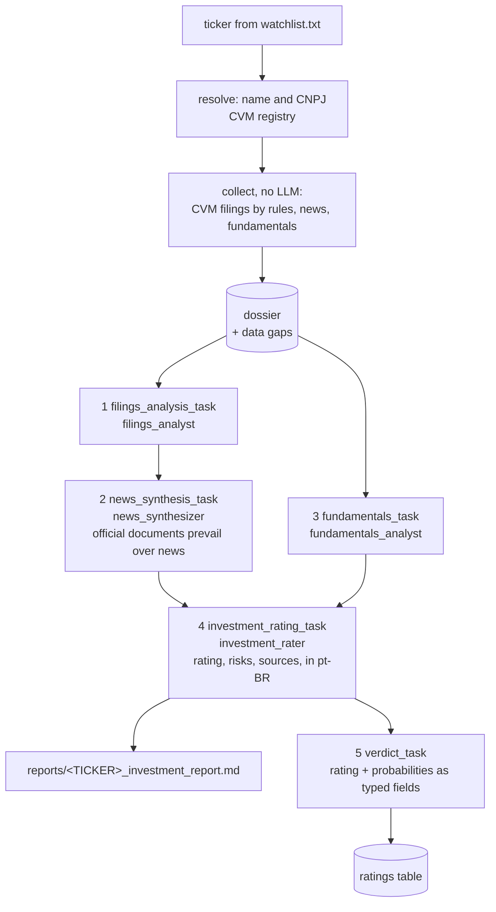

# CrewAI Invest Reporter

AI agents (in **pt-BR**) on a fixed list of B3 stocks, two ways:

- **Daily email (public):** every trading morning, before B3 opens, one agent writes a short
  "what's new" per stock from the latest news and CVM filings. This runs **once** for the
  whole watchlist; anyone can pick stocks on a sign-up page and receives that day's
  briefings for them. News only, never buy/sell advice.
- **Full reports (private):** four agents rate a stock (official reports, news,
  fundamentals) and write a report to `reports/<TICKER>_investment_report.md`. The verdict
  (rating and probabilities), with the day's price and fundamentals, is saved to SQLite, to
  compare later with what the stock really did.

All data is collected with fixed rules and no LLM: the company's **official reports** (CVM
filings), recent news (Google News RSS) and fundamentals (Investidor10).

## Quick start

```bash
curl -LsSf https://astral.sh/uv/install.sh | sh   # or: pip install uv
uv sync --extra dev
cp .env.example .env                               # then fill in your keys

uv run python -m crewai_invest_reporter.main dossier PETR4      # no LLM: what agents will read
uv run python -m crewai_invest_reporter.main daily --no-email   # today's digests, no emails
uv run python -m crewai_invest_reporter.main report PETR4       # full report + saved rating
```

| Command | What it does | LLM? |
|---|---|---|
| `daily [--no-email]` | Builds today's digest of every watchlist stock (once a day), then emails confirmed subscribers who haven't had it | yes, 1 call per stock with something new |
| `web [--host H] [--port N]` | Serves the sign-up page | no |
| `report [TICKER ...]` | Full report per stock (the tickers given, or the whole watchlist); verdict saved to the database | yes, 5 calls per stock |
| `dossier TICKER [--json]` | Collects and prints everything the full report's agents will read | no |

Also available as `make daily`, `make web`, `make run [TICKER=PETR4]` and
`make dossier TICKER=PETR4`.

## The watchlist

`watchlist.txt` holds the stocks to report on, one B3 ticker per line. Blank lines and
anything after `#` are ignored:

```text
PETR4
VALE3   # mineração
BRBI11
```

Every ticker must be a company in CVM's registry (units such as BRBI11 included); a typo
fails that stock with a clear message and the others still run. Point `WATCHLIST_FILE` at
another file to keep a different list.

## Daily email

```text
trading day, 09:00 Brasília (cron)          sign-up page (public)
  daily: for each watchlist stock             pick stocks + email
    news + CVM filings since the last digest    -> confirmation link by email
    nothing new? no LLM call                    -> confirmed: today's email at once,
    else 1 agent writes 2-5 bullet points          if the digests are built
  -> digests saved in SQLite (reporter.db)
  -> one email per confirmed subscriber, with only their stocks
```

- **Once per day:** the digests are built once for the whole watchlist and reused for every
  subscriber, so the LLM cost does not grow with the number of people. Running `daily` twice
  the same day builds nothing again and sends nobody a second email.
- **What's new:** news and CVM filings from the days since the stock's previous digest whose
  links were not reported yet. New filings are read (up to 3, 4k characters each). The price
  move is today's Investidor10 price against the previous digest's.
- **Content rules:** the agent reports facts with their source and never recommends buying,
  selling or holding. In Brazil, publishing investment recommendations to the public is
  reserved to CVM-accredited analysts (Resolução CVM 20), so the public email stays
  news-only; the ratings of the full reports stay private.

### Subscribers and privacy (LGPD)

- A sign-up (new, or a change of stocks) only takes effect when the link emailed to the
  address is opened within 2 days, so nobody can subscribe someone else. The link opens a
  page with a button: mailbox scanners that open links can't confirm on the user's behalf.
- Every email has an unsubscribe link and the `List-Unsubscribe` one-click headers that
  Gmail and Yahoo expect. Unsubscribing **deletes** the subscriber; unconfirmed sign-ups are
  deleted after 7 days. The privacy page (`/privacidade`) says this, with `CONTACT_EMAIL`.
- Only the email, the chosen stocks and dates are stored.

### Going live

1. **Email service and domain.** Use a transactional email service with SMTP (Brevo, Amazon
   SES, Resend, OCI Email Delivery...) and a domain you control, with the SPF and DKIM
   records the service gives you: without them, mail to Gmail/Outlook lands in spam. A
   DuckDNS name can't hold those records. Fill in the `SMTP_*`, `MAIL_FROM` and
   `PUBLIC_URL` variables.
2. **Page.** Run `web` on the VM (it listens on 127.0.0.1:8000) behind nginx with HTTPS. Pass
   the `Host` header (the page refuses cross-site posts by comparing it) and rate-limit
   sign-ups, e.g.:
   ```nginx
   limit_req_zone $binary_remote_addr zone=signup:10m rate=5r/m;   # in http { }
   location = /inscrever {
       limit_req zone=signup burst=5 nodelay;
       proxy_pass http://127.0.0.1:8000;
       proxy_set_header Host $host;
   }
   location / {
       proxy_pass http://127.0.0.1:8000;
       proxy_set_header Host $host;
   }
   ```
3. **Schedule.** Brazil has no daylight saving time, so 09:00 in Brasília is 12:00 UTC:
   ```cron
   0 12 * * 1-5  cd /path/to/CrewAI-Invest-Reporter && .venv/bin/python -m crewai_invest_reporter.main daily >> daily.log 2>&1
   ```
   B3 holidays are not skipped yet: on those days the email covers the news as usual.

## Ratings memory

Each `report` run saves a row in the `ratings` table of `reporter.db`: day, ticker, rating
category, `probability_good` / `probability_loss` (the "Risco do Investimento" percentages),
the confidence, the price and every fundamental of that day, the model used and the full
report. Every run is kept, so the same stock can be rated daily, or by several models.

A fifth task in the crew copies the report's conclusion into typed fields (validated with
Pydantic), so nothing is parsed from markdown. If that step fails, the report is still
written and the rating is skipped, with a warning.

The `digests` table holds one price per stock per trading morning (run `daily` every
trading day, `--no-email` is enough), which gives the "what happened next" side:

```sql
-- Each rating with the price 30 days later
SELECT r.day, r.ticker, r.rating, r.probability_good, r.price AS price_then,
       (SELECT d.price FROM digests d
         WHERE d.ticker = r.ticker AND d.day >= date(r.day, '+30 days')
         ORDER BY d.day LIMIT 1) AS price_30d_later
FROM ratings r ORDER BY r.day;
```

## LLM gateway (Bifrost)

The agents' LLM calls go through our self-hosted [Bifrost](https://github.com/maximhq/bifrost)
gateway on OCI. It puts OpenAI, Anthropic and Gemini behind one OpenAI-compatible API, and its
dashboard logs every call with tokens, cost and latency. Each project has its own virtual key,
with its own budget, rate limit and allowed models.

1. Create a virtual key for this project in the Bifrost dashboard (Virtual keys page).
2. Put it in `.env`:
   ```bash
   BIFROST_BASE_URL=https://<gateway host>/v1   # from anywhere, over HTTPS
   # BIFROST_BASE_URL=http://<gateway private IP>:8080/v1   # OCI instance in the same VCN
   BIFROST_API_KEY=sk-bf-...
   MODEL=openai/gpt-4.1-mini                    # or anthropic/..., gemini/...
   ```
3. Run as usual. The calls appear on the dashboard's Logs page.

Only the inference API (`/v1/*`) is public, served over HTTPS (Let's Encrypt) by an nginx
reverse proxy on the gateway VM, with a per-IP rate limit. Every other path returns 404, and
requests for any other hostname or the bare IP are refused. The dashboard is not public: open
it through an SSH tunnel (`ssh -L 8080:127.0.0.1:8080 bifrost`, then http://localhost:8080).

`MODEL` must be a model the virtual key allows, written `provider/model`. Without `MODEL`,
`openai/gpt-4.1-mini` is used. The key is sent both as `Authorization: Bearer` and as
Bifrost's `x-bf-vk` header.

To skip the gateway, leave `BIFROST_BASE_URL` empty: CrewAI then calls the provider directly
with `OPENAI_API_KEY` (or another provider's key) and `MODEL`.

## Deterministic research

All data is collected by plain Python code before any agent runs
(`services/research.py`). Fixed sources, fixed queries, fixed selection rules and fixed
text budgets mean that two runs on the same day give the agents the same inputs, and the
agents have no tools to go looking elsewhere. Run `dossier <ticker>` to see exactly what
they will receive.

| Source (no API key) | What is collected |
|---|---|
| **CVM open data**, FCA dataset | the ticker's company: legal name and CNPJ |
| **CVM open data**, IPE dataset (last 180 days) | 1 earnings release (15k chars), 2 fatos relevantes (5k each), 1 dividend notice (3k), 1 comunicado (3k); up to 10 other filings by title |
| **Investidor10** | price, 12-month change, P/L, P/VP, dividend yield, dividends paid |
| **Google News RSS** | up to 15 headlines from the last 30 days |

CVM datasets are cached on disk for 6 hours (`CACHE_DIR`). If CVM is down, the last cached
copy is used. A source that fails doesn't stop the report: the failure is written into the
dossier's `data_gaps`, and the agents are told to lower their confidence and mention it.

The document reader extracts text from PDF, HTML and XML. It only fetches public `http(s)`
addresses, re-checks every redirect, and caps downloads at 25 MB.

## Architecture

The domain layer has no external dependencies, and every external service sits behind a
small protocol (`domain/ports.py`), so tests swap in fakes.

```
src/crewai_invest_reporter/
├── main.py                 # CLI: daily, web, report, dossier
├── web.py                  # public sign-up page (Flask) + templates/
├── watchlist.py            # reads watchlist.txt
├── bootstrap.py            # Container: wires concrete providers/crews (composition root)
├── settings.py             # typed settings from env vars
├── domain/
│   ├── models.py           # Stock, Filing, ResearchDossier, Digest, Subscriber, Verdict…
│   ├── ports.py            # one small protocol per external capability
│   ├── tickers.py          # B3 ticker normalization/validation
│   ├── cnpj.py             # CNPJ normalization with check digits
│   └── errors.py
├── providers/              # adapters to the outside world
│   ├── database.py         # SQLite: digests, subscribers, deliveries, ratings
│   ├── smtp.py             # sends email through any SMTP server
│   ├── cvm.py              # CVM open data: cached client, company registry, IPE filings
│   ├── investidor10.py     # parser (pure) + provider (HTTP)
│   ├── google_news.py
│   ├── documents.py        # safe PDF/HTML/XML reader
│   ├── cache.py            # disk cache with stale fallback
│   ├── parsing.py          # Brazilian number parsing
│   └── http.py             # session with retries/backoff
├── crews/                  # __init__.py: prompt helpers shared by both crews
│   ├── daily_news/         # 1 agent: the daily "what's new" briefing
│   └── asset_report/       # 4 agents + verdict extraction: reports → news → fundamentals → rating
└── services/
    ├── research.py         # ResearchCollector + document selection rules (deterministic)
    ├── daily.py            # builds the day's digests once
    ├── subscriptions.py    # sign-up, confirmation, unsubscribe, daily sending
    ├── emails.py           # email texts (pt-BR, plain text)
    ├── stocks.py           # ticker -> company (CVM registry)
    └── reporting.py        # full report: resolve → collect → analyze → write → save rating
```

### Full report flow



## Configuration

| Variable | Required for | Default |
|---|---|---|
| `BIFROST_BASE_URL` | `report` through the [LLM gateway](#llm-gateway-bifrost) | – |
| `BIFROST_API_KEY` | with `BIFROST_BASE_URL`; this project's virtual key | – |
| `OPENAI_API_KEY` (or another CrewAI LLM provider's key) | `report` without the gateway | – |
| `MODEL` | optional; with the gateway, a `provider/model` name | `openai/gpt-4.1-mini` with the gateway, otherwise CrewAI's default |
| `SMTP_HOST`, `MAIL_FROM` | `daily` and `web` (see [Daily email](#daily-email)) | – |
| `SMTP_PORT`, `SMTP_USERNAME`, `SMTP_PASSWORD` | your email service's SMTP credentials | `587`, –, – |
| `SMTP_SECURITY` | `starttls`, `ssl` or `none` (local test server only) | `starttls` |
| `PUBLIC_URL` | address of the sign-up page, used in email links | `http://127.0.0.1:8000` |
| `CONTACT_EMAIL` | shown on the privacy page | – |
| `DATABASE_FILE` | optional; the SQLite file | `reporter.db` |
| `WATCHLIST_FILE` | optional | `watchlist.txt` |
| `REPORTS_DIR` | optional | `reports` |
| `CACHE_DIR` | optional; cache for CVM downloads | `~/.cache/crewai_invest_reporter` |
| `HTTP_TIMEOUT_SECONDS` | optional | `15` |

Never commit your `.env` file.

## Development

```bash
make check     # ruff format --check + ruff check + pytest
make test
```

The tests don't touch the network or an LLM. HTTP calls are mocked with `responses`, and
crews and providers are replaced with fakes through the ports. CI
(`.github/workflows/ci.yml`) runs lint and tests on Python 3.10 to 3.13.

## Limitations

- News items are headlines only; the in-depth reading is done on the official reports.
- Only the beginning of each document is read, within its character budget.
- Scanned PDFs, which contain images rather than text, can't be read because there is no OCR.
- Investidor10 is scraped, so the parser may break when the site changes. Missing metrics
  are reported as "Não disponível" and are never estimated.

- B3 holidays are not skipped by `daily` yet.
- Emails are sent one connection each, fine for hundreds of subscribers, not for tens of
  thousands.

> These reports are produced by AI from public data. They are **not** a formal investment
> recommendation.
