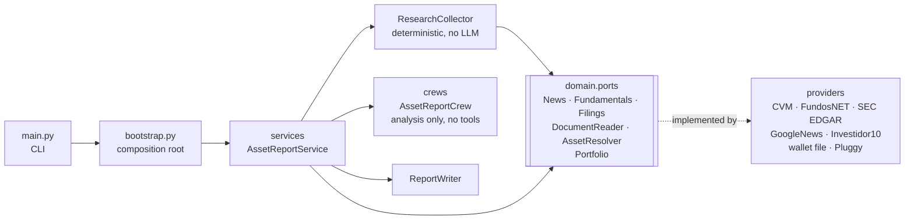
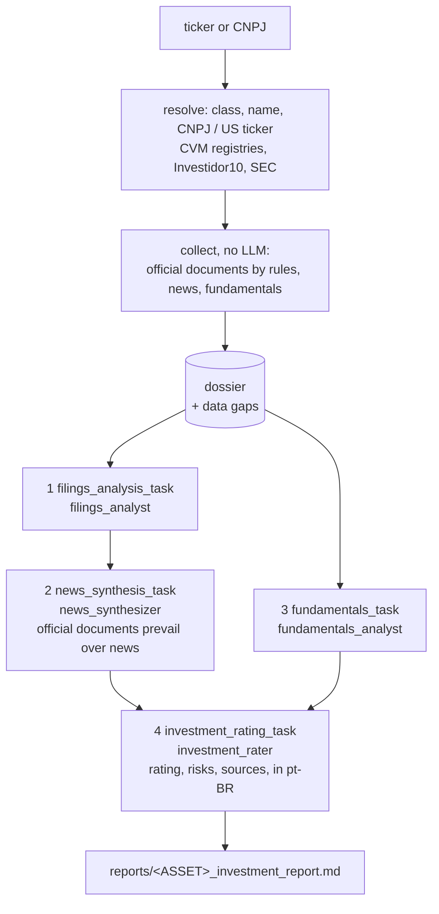

# CrewAI Invest Reporter

AI-agent investment reports (in **pt-BR**) for the stocks and funds (stocks, FIIs, ETFs,
BDRs and investment funds) in your wallet. You type your holdings in on a small
**wallet page**, or read them from Nubank / NuInvest through **Open Finance**.

- **Asset report**: the code first collects, with fixed rules and no LLM, the asset's latest
  **official reports** (CVM filings for companies, B3 FundosNET documents such as
  *relatórios gerenciais* for FIIs, SEC filings for BDRs), recent news (Google News RSS) and
  fundamentals (Investidor10). The agents then analyze that bundle and write an investment
  rating with risks, "what would change my view" and the list of sources.
- **Holdings**: the stocks and funds you hold, from the wallet page (default) or Pluggy Open
  Finance. Stocks, FIIs, ETFs and BDRs are valued at the day's quote.
- **Inspection commands** with no LLM calls: your holdings and the exact research bundle
  (the "dossier") the agents will read.

Reports are written to `reports/` (configurable with `REPORTS_DIR`).

## Quick start

```bash
curl -LsSf https://astral.sh/uv/install.sh | sh   # or: pip install uv
uv sync --extra dev
cp .env.example .env                               # then fill in your keys

uv run python -m crewai_invest_reporter.main web                # wallet page on http://127.0.0.1:8000
uv run python -m crewai_invest_reporter.main holdings
uv run python -m crewai_invest_reporter.main dossier MXRF11     # no LLM: what agents will read
uv run python -m crewai_invest_reporter.main asset MXRF11
```

| Command | What it does | LLM? |
|---|---|---|
| `web [--host H] [--port N]` | Serves the wallet page, where you type in your stocks and funds | no |
| `holdings [--json]` | Prints your stocks and funds, valued at the day's quote | no |
| `dossier <TICKER or CNPJ> [--json]` | Collects and prints everything the agents will read | no |
| `asset <TICKER or CNPJ>` | Report for one asset → `reports/<TICKER>_investment_report.md` (funds: `FUNDO_<CNPJ>_…`) | yes |

The same commands are available through `make web`, `make holdings`,
`make dossier TICKER=MXRF11` and `make run TICKER=MXRF11`.

## Your wallet

`web` serves a small page where you add each asset you hold:

- **Stocks, FIIs, ETFs and BDRs**: the ticker (autocompleted from CVM's lists) and the
  number of shares. `holdings` values them at the day's quote from Investidor10.
- **Investment funds**: the fund's CNPJ and its value in R$, since funds have no quote.
  Give the fund's name too: it is used to search news about it.
- **Import from B3**: in B3's Área do Investidor, download your position as Excel
  (`posicao-*.xlsx`) and upload it. Every tab with the columns "Código de Negociação" and
  "Quantidade" is read (stocks, FIIs, ETFs, BDRs), a ticker held at two brokers is summed,
  and the result **replaces** your ticker entries. Funds added by CNPJ are kept.

Adding an asset that is already there replaces its amount; each one can also be edited or
removed. Everything is saved to `wallet.json` (`WALLET_FILE`), which is git-ignored because
it holds your personal data.

The page has no login: it listens only on `127.0.0.1`. Before making it reachable from
another machine, put it behind a password (e.g. nginx basic auth). It refuses form posts
coming from other websites.

To read holdings from Open Finance instead, set `WALLET_SOURCE=pluggy` and follow the next
section.

## LLM gateway (Bifrost)

The agents' LLM calls go through our self-hosted [Bifrost](https://github.com/maximhq/bifrost)
gateway on OCI. It puts OpenAI, Anthropic and Gemini behind one OpenAI-compatible API, and its
dashboard logs every call with tokens, cost and latency. Each project has its own virtual key,
with its own budget, rate limit and allowed models.

1. Create a virtual key for this project in the Bifrost dashboard (Virtual keys page).
2. Put it in `.env`:
   ```bash
   BIFROST_BASE_URL=https://<gateway host>/v1   # from anywhere, over HTTPS
   # BIFROST_BASE_URL=http://<gateway private IP>:8080/v1   # OCI instance in the same VCN
   BIFROST_API_KEY=sk-bf-...
   MODEL=openai/gpt-4.1-mini                    # or anthropic/..., gemini/...
   ```
3. Run as usual. The calls appear on the dashboard's Logs page.

Only the inference API (`/v1/*`) is public, served over HTTPS (Let's Encrypt) by an nginx
reverse proxy on the gateway VM, with a per-IP rate limit. Every other path returns 404, and
requests for any other hostname or the bare IP are refused. The dashboard is not public: open
it through an SSH tunnel (`ssh -L 8080:127.0.0.1:8080 bifrost`, then http://localhost:8080).

`MODEL` must be a model the virtual key allows, written `provider/model`. Without `MODEL`,
`openai/gpt-4.1-mini` is used. The key is sent both as `Authorization: Bearer` and as
Bifrost's `x-bf-vk` header. A call without a valid key gets `401` once the gateway enforces
virtual keys on inference.

To skip the gateway, leave `BIFROST_BASE_URL` empty: CrewAI then calls the provider directly
with `OPENAI_API_KEY` (or another provider's key) and `MODEL`.

## Open Finance (Nubank / NuInvest), optional

Instead of typing your holdings in, you can read them automatically from Nubank / NuInvest
with `WALLET_SOURCE=pluggy`.

Brazilian Open Finance APIs can only be called directly by institutions regulated by the
Central Bank, so the project uses **[Pluggy](https://pluggy.ai)**, an Open Finance
aggregator that supports Nubank and NuInvest. For personal use, the **MeuPluggy** connector
lets you share your own accounts with your own app.

### One-time setup

1. **Connect your banks.** Sign up at [meu.pluggy.ai](https://meu.pluggy.ai), click
   *Connect*, and authorize **Nubank** and **NuInvest** through the official Open Finance flow.
2. **Create a developer app.** Sign up at [dashboard.pluggy.ai](https://dashboard.pluggy.ai)
   (this starts a trial), enable the **MeuPluggy** connector, and create a *Development
   Application*. Copy its `CLIENT_ID` and `CLIENT_SECRET`.
3. **Link MeuPluggy to the app.** In the dashboard's *Demo* application, connect
   **MeuPluggy** and complete its OAuth authorization **once per institution** (once for
   Nubank, once for NuInvest). Each authorization creates an **item**. Copy each item's id.
4. **Configure `.env`:**

   ```bash
   WALLET_SOURCE=pluggy
   PLUGGY_CLIENT_ID=...
   PLUGGY_CLIENT_SECRET=...
   PLUGGY_ITEM_IDS=<nubank-item-id>,<nuinvest-item-id>
   ```

5. Check it with `holdings`. No LLM is called, so this costs nothing:

   ```bash
   uv run python -m crewai_invest_reporter.main holdings
   ```

MeuPluggy refreshes the underlying Open Finance connections daily. Open Finance consents
expire (usually after 12 months), so renew them at meu.pluggy.ai when that happens.

### What is imported

| Pluggy data | Mapped to |
|---|---|
| `EQUITY` (subtypes `STOCK`, `BDR`, `REAL_ESTATE_FUND`) | `STOCK`, `BDR`, `REAL_ESTATE_FUND` (FIIs) |
| `ETF` | `ETF` |
| `MUTUAL_FUND` | `MUTUAL_FUND` |
| `FIXED_INCOME`, `SECURITY` (PGBL / VGBL), `COE`, options | skipped |

Fully withdrawn and zero-balance positions are skipped, and so are bank accounts and credit
cards. If one institution fails, the others are still reported and the failure is listed
under "errors".

> **Pricing note:** MeuPluggy is free for individuals, and the Pluggy developer dashboard
> starts with a trial. Check Pluggy's current plans before relying on it long term. The code
> is written against an abstraction (`PortfolioProvider`), so another aggregator (Belvo,
> etc.) can be plugged in by writing one new provider class.

## Deterministic research

All data is collected by plain Python code before any agent runs
(`services/research.py`). Fixed sources, fixed queries, fixed selection rules and fixed
text budgets mean that two runs on the same day give the agents the same inputs, and the
agents have no tools to go looking elsewhere. Run `dossier <ticker>` to see exactly what
they will receive.

### Sources per asset type

| Asset | Official source (no API key) | Documents selected, newest first (character budget) |
|---|---|---|
| Stocks and units (PETR4, TAEE11…) | **CVM open data**, IPE dataset | 1 earnings release (15k), 2 fatos relevantes (5k each), 1 dividend notice (3k), 1 comunicado (3k) |
| FIIs (MXRF11…) | **B3 FundosNET** | 1 relatório gerencial (15k), 2 fatos relevantes (5k each), 1 dividend notice (3k), 1 informe mensal (5k) |
| Investment funds (by CNPJ) | B3 FundosNET, when the fund publishes there | 1 relatório (12k), 2 fatos relevantes (4k each), 1 informe (4k) |
| BDRs (AAPL34, M1TA34…) | **SEC EDGAR**, filings of the US company | 1 earnings press release (15k), 2 other 8-Ks (3k each) |
| ETFs (BOVA11…) | none; recorded as a data gap | – |

In addition, every asset gets fundamentals from Investidor10 and up to 15 Google News
headlines from the last 30 days.

How assets are identified:
- **Stocks**: CVM's FCA dataset maps the ticker to the company's CNPJ.
- **FIIs**: CVM's FII monthly-report dataset maps the ticker to the fund's CNPJ (through
  the ISIN code).
- **BDRs**: Investidor10's page gives the US ticker ("Nasdaq sob o ticker AAPL"), and
  SEC's ticker list gives the company's CIK.

CVM and SEC lists are cached on disk for 24 hours (`CACHE_DIR`). If a source is down, the
last cached copy is used. A source that fails doesn't stop the report: the failure is
written into the dossier's `data_gaps`, and the agents are told to lower their confidence
and mention it.

The document reader extracts text from PDF, HTML and XML. It only fetches public `http(s)`
addresses, re-checks every redirect, and caps downloads at 25 MB.

## Architecture

The code follows a ports-and-adapters layout. The domain layer has no external
dependencies, and every external service sits behind a small protocol.



```
src/crewai_invest_reporter/
├── main.py                 # CLI
├── web.py                  # wallet page (Flask) + templates/wallet.html
├── bootstrap.py            # Container: wires concrete providers/crews (composition root)
├── settings.py             # typed settings from env vars
├── domain/
│   ├── models.py           # AssetRef, Filing, ResearchDossier, Holding, Portfolio…
│   ├── ports.py            # one small protocol per external capability
│   ├── tickers.py          # B3 ticker normalization/validation
│   ├── cnpj.py             # CNPJ normalization with check digits
│   └── errors.py
├── providers/              # adapters to the outside world
│   ├── google_news.py
│   ├── investidor10.py     # parser (pure) + provider (HTTP), with category fallback
│   ├── wallet.py           # wallet page's JSON file + provider valuing it at the day's quote
│   ├── b3_position.py      # reads the position .xlsx exported from B3's Área do Investidor
│   ├── pluggy.py           # Open Finance: client (auth/pagination) + mapper + provider
│   ├── cvm.py              # CVM open data: cached client, registries, IPE filings
│   ├── fundosnet.py        # B3 FundosNET fund documents
│   ├── sec_edgar.py        # SEC filings of the US companies behind BDRs
│   ├── cache.py            # disk cache with stale fallback (CVM, SEC lists)
│   ├── assets.py           # ticker/CNPJ resolver + routing of filings by asset class
│   ├── documents.py        # safe PDF/HTML/XML reader (+ in-memory cache decorator)
│   ├── parsing.py          # Brazilian number parsing
│   └── http.py             # session with retries/backoff
├── crews/
│   └── asset_report/       # 4 agents: official reports → news synthesis → fundamentals → rating
│       └── guidelines.py   # what to analyze per asset class (FII ≠ stock ≠ ETF ≠ fund)
└── services/
    ├── research.py         # ResearchCollector + document selection rules (deterministic)
    ├── reporting.py        # orchestration: resolve → collect → analyze → write
    └── report_writer.py
```

How the code applies SOLID:

- **Single responsibility:** fetching (providers), parsing (`Investidor10Parser`,
  `PluggyInvestmentMapper`), choosing what to read (`ResearchCollector`), LLM reasoning
  (crews), orchestration (services) and persistence (`ReportWriter`) are separate classes.
- **Open/closed:** a new data source is a new provider class, and a new document type is a
  new `SelectionRule`. Crews and services stay unchanged.
- **Liskov substitution and interface segregation:** the protocols are small (one method
  each), so fakes in the tests and real adapters can be swapped freely.
- **Dependency inversion:** services and the collector depend on `domain.ports`. Only
  `bootstrap.py` knows the concrete classes.

### Asset report flow



Asset-class guidance from `crews/asset_report/guidelines.py` is added to the prompts, so
FIIs are judged on vacancy, default rate, distributions and P/VP rather than P/L; ETFs on
index, fees and liquidity; BDRs on the US company's results; and funds on returns against
their benchmark, fees and liquidity.

## Configuration

| Variable | Required for | Default |
|---|---|---|
| `BIFROST_BASE_URL` | `asset` through the [LLM gateway](#llm-gateway-bifrost) | – |
| `BIFROST_API_KEY` | with `BIFROST_BASE_URL`; this project's virtual key | – |
| `OPENAI_API_KEY` (or another CrewAI LLM provider's key) | `asset` without the gateway | – |
| `MODEL` | optional; with the gateway, a `provider/model` name | `openai/gpt-4.1-mini` with the gateway, otherwise CrewAI's default |
| `WALLET_SOURCE` | optional: `manual` (the wallet page) or `pluggy` (Open Finance) | `manual` |
| `WALLET_FILE` | optional; where the wallet page saves your holdings | `wallet.json` |
| `PLUGGY_CLIENT_ID`, `PLUGGY_CLIENT_SECRET`, `PLUGGY_ITEM_IDS` | `holdings` with `WALLET_SOURCE=pluggy` | – |
| `SEC_USER_AGENT` | optional; your name and email, as SEC asks of automated clients | `crewai-invest-reporter/0.1` |
| `CACHE_DIR` | optional; cache for CVM/SEC downloads | `~/.cache/crewai_invest_reporter` |
| `REPORTS_DIR` | optional | `reports` |
| `HTTP_TIMEOUT_SECONDS` | optional | `15` |

Never commit your `.env` file.

## Development

```bash
make check     # ruff format --check + ruff check + pytest
make test
```

The tests don't touch the network or an LLM. HTTP calls are mocked with `responses`, and
crews and providers are replaced with fakes through the ports. CI
(`.github/workflows/ci.yml`) runs lint and tests on Python 3.10 to 3.13.

## Limitations

- News items are headlines only; the in-depth reading is done on the official reports.
- FundosNET is slow at times. Requests have a 60-second timeout and are retried.
- ETFs have no issuer documents. Their reports rely on market data and news.
- Only the beginning of each document is read, within its character budget. For long
  relatórios gerenciais this covers the highlights, not every table.
- Scanned PDFs, which contain images rather than text, can't be read because there is no OCR.
- Investidor10 is scraped, so the parser may break when the site changes. Missing metrics
  are reported as "Não disponível" and are never estimated.
- Open Finance data depends on what each institution shares and on how often the connection
  is refreshed.

> These reports are produced by AI from public and Open Finance data. They are **not** a
> formal investment recommendation.
